  <a href="https://github.com/dutaalamin">
    <picture>
      <source media="(prefers-color-scheme: dark)" srcset="img/welcome-dark.gif">
      <source media="(prefers-color-scheme: light)" srcset="img/welcome-light.gif">
      
    </picture>
  </a>

<!-- Social icons (self-hosted) -->

  
  &#8287;&#8287;&#8287;&#8287;
  
  &#8287;&#8287;&#8287;&#8287;
  
  &#8287;&#8287;&#8287;&#8287;
  

 

<h2 align="center">Hi, I'm Duta</h2>

  Web developer. I build the whole thing &mdash; interface, state, data, and the tests that hold it together.

 

My work tends to sit close to the user. A school site that has to survive
open-house traffic. An AI chat app where a dropped token must not corrupt the
conversation. A typing test whose regressions get caught by Playwright before
anyone clicks. When the browser is the wrong tool, I write the Windows side in
C++ instead.

<table>
<tr>
<td valign="top" width="33%"><b>Shipping now</b> Kora &mdash; AI chat with streaming replies, voice mode, and file parsing.</td>
<td valign="top" width="33%"><b>Recently delivered</b> TK Al-Madina &mdash; kindergarten site running open house and admissions.</td>
<td valign="top" width="33%"><b>Deep end</b> Glance &mdash; Win32 notch launcher with hand-written Direct2D and COM.</td>
</tr>
</table>

 

  
  
  
  
  
  
  
  
  

 

  
<h2>Statistics</h2>

  

    
  

  

    
  

   

  

    <picture>
      <source media="(prefers-color-scheme: dark)" srcset="assets/pacman-dark.svg">
      <source media="(prefers-color-scheme: light)" srcset="assets/pacman-light.svg">
      
    </picture>
  

 

  

