

  <a href="https://github.com/dutaalamin">
    <picture>
      <source media="(prefers-color-scheme: dark)" srcset="img/welcome-dark.gif">
      <source media="(prefers-color-scheme: light)" srcset="img/welcome-light.gif">
      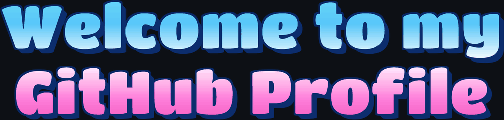
    </picture>
  </a>

  
  &#8287;&#8287;&#8287;&#8287;
  
  &#8287;&#8287;&#8287;&#8287;
  
  &#8287;&#8287;&#8287;&#8287;
  

<h2 align="center">Hi, I'm Duta</h2>

  Software engineer. I build websites, apps, and AI tools.

I am Duta, a software engineer from Indonesia. I work on web projects, mostly
with React, Vue, and Laravel, and lately I spend a lot of time building with AI.

I usually handle a project alone, from the first design to the day it goes live.
That means writing the interface, the backend, and fixing whatever breaks after
people start using it.

I also build desktop apps and small utilities, the kind that make a boring task
take two seconds instead of twenty.

A lot of my work is helping people get online. Someone needs a site for their
school, their business, their portfolio, and I build it for them and keep it
running. That part is satisfying in a way side projects are not, because you can
see who it is for.

  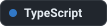
  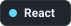
  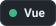
  
  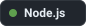
  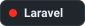
  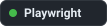
  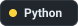
  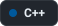

<h2>Statistics</h2>

  

  

  <picture>
    <source media="(prefers-color-scheme: dark)" srcset="assets/languages-dark.svg">
    <source media="(prefers-color-scheme: light)" srcset="assets/languages-light.svg">
    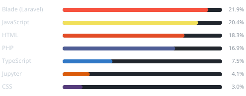
  </picture>

  <picture>
    <source media="(prefers-color-scheme: dark)" srcset="assets/pacman-dark.svg">
    <source media="(prefers-color-scheme: light)" srcset="assets/pacman-light.svg">
    
  </picture>

  

